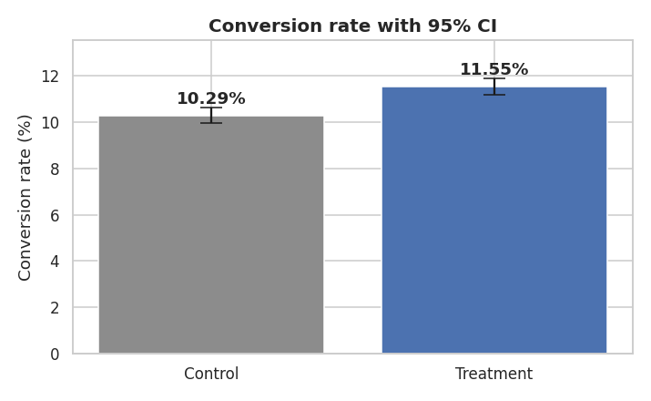
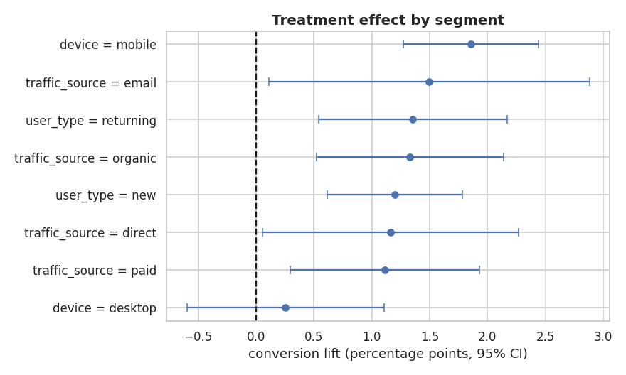

# 🧪 A/B Test Analysis: Checkout Redesign

  

> **Rigorous analysis of a 64,000-user experiment: randomisation checks, power analysis, hypothesis testing, confidence intervals, segment effects and a ship / no-ship recommendation.**
> 📓 **[Open the notebook](notebooks/03_ab_test_checkout_analysis.ipynb)**

## 🎯 Business problem
The product team replaced a 3-step checkout with a one-page checkout and ran a 14-day, 50/50 randomised experiment.
**Should the company roll it out?**

| Item | Choice |
|---|---|
| Primary metric | Conversion rate |
| Secondary metric | Revenue per user |
| Guardrail | Average order value must not drop |
| α / power | 0.05 / 80% |

## 🔬 Method
1. **Data validation:** duplicates, nulls, date range, metric logic
2. **Randomisation checks:** sample-ratio-mismatch (χ²) and covariate balance
3. **Power analysis:** users required vs users available
4. **Primary test:** two-proportion z-test, 95% CI for the lift
5. **Secondary & guardrail:** bootstrap CI on revenue per user, Mann-Whitney on order value
6. **Segment analysis:** device, user type, traffic source with **Holm multiple-testing correction**
7. **Interaction test:** logistic regression (`treatment × device`)
8. **Novelty check:** week 1 vs week 2, daily lift trend
9. **Business impact & decision**

## 📊 Results
| Metric | Control | Treatment | Result |
|---|---|---|---|
| Conversion rate | 10.29% | 11.55% | **+1.26 pp (+12.2%)**, 95% CI [+0.78, +1.74], p = 3e-07 |
| Revenue per user | ₹200 | ₹226 | **+₹25**, bootstrap CI [₹13.5, ₹37.5] |
| Avg. order value (guardrail) | ₹1,948 | ₹1,954 | No change (p = 0.77) ✅ |

**Segment insight:** the effect is **concentrated on mobile (+1.86 pp, significant after correction)**; desktop shows no reliable change
(+0.25 pp, CI crosses 0). The `treatment × device` interaction is significant (p = 0.0004), so the difference between devices is real.
The mobile lift stays positive in week 2 (+1.72 pp vs +2.00 pp in week 1), so it isn't just a novelty effect.




## ✅ Decision
**Ship the new checkout, starting with mobile at 100%.** Keep a desktop holdout and investigate why desktop did not respond.
Expected impact: ~1,260 extra orders per 100,000 visitors (≈ ₹25 L extra revenue).

## 🗂️ Project structure
```
├── data/ab_test_checkout.csv        # 64,000 users: group, device, user type, source, converted, revenue
├── notebooks/03_ab_test_checkout_analysis.ipynb
├── images/
├── src/generate_data.py             # seeded synthetic data generator
└── requirements.txt
```

## ▶️ Run it yourself
```bash
git clone https://github.com/singhji777/ab-test-checkout-redesign.git
cd ab-test-checkout-redesign
pip install -r requirements.txt
jupyter notebook notebooks/03_ab_test_checkout_analysis.ipynb
```

## ⚠️ Data note & limitations
Data is **synthetic**, generated with known effects so the methodology can be demonstrated end-to-end. 14 days is short: long-term retention
and seasonality are not measured, and the segment findings are exploratory and should be confirmed with a follow-up test.

## 👤 Author
**Aditya Singh** · [GitHub](https://github.com/singhji777)
